# CI/CD Demo for a Java Web Application

This project demonstrates an end-to-end DevOps workflow for a Java web application using Maven, Docker, Kubernetes, GitHub Actions, and Ansible. The application exposes a simple REST API and health endpoint, and the pipeline automatically builds, tests, packages, and deploys the service whenever changes are pushed to the repository.

## Project architecture

```mermaid
flowchart LR
    A[Developer pushes code] --> B[GitHub Repository]
    B --> C[GitHub Actions workflow]
    C --> D[Maven: build + test]
    D --> E[Docker build + tag]
    E --> F[Push image to GHCR]
    F --> G[Kubernetes deployment]
    G --> H[LoadBalancer service]
    H --> I[Browser / HTTP endpoint]
```



## Tech stack

- Java 17
- Maven
- Spring Boot 3.3.4
- Docker
- Kubernetes
- GitHub Actions
- Ansible
- Azure Kubernetes Service (AKS) deployment target

## Local development

### Prerequisites

- Java 17+
- Maven 3.9+
- Docker Desktop or a Docker engine
- kubectl (for Kubernetes validation)

### Run the app locally

```bash
mvn clean test
mvn spring-boot:run
```

Then open the following endpoints in the browser:

- http://localhost:8080/
- http://localhost:8080/health
- http://localhost:8080/api/version

### Build the Docker image locally

```bash
docker build -t cicd-demo:local .
docker run --rm -p 8080:8080 cicd-demo:local
```

## CI/CD pipeline overview

The GitHub Actions workflow performs the following stages:

1. Check out the source code.
2. Install Java 17 and Maven dependencies.
3. Run the automated test suite.
4. Package the application into a JAR file.
5. Build the Docker image.
6. Push the image to GitHub Container Registry.
7. Authenticate to Azure.
8. Update the AKS deployment with the new image.
9. Wait for the rollout to finish.

The deployment files are in the `k8s/` folder.

## Kubernetes deployment

Apply the manifests with:

```bash
kubectl apply -f k8s/
```

The deployment creates a namespace named `cicd-demo`, deploys two replicas, and exposes the application through a `LoadBalancer` service.

## Ansible automation

The Ansible example in `ansible/playbook.yml` demonstrates how to create the target namespace and apply the Kubernetes manifests to a cluster.

```bash
ansible-playbook -i ansible/inventory/hosts.ini ansible/playbook.yml
```

## Security and operational considerations

- Use GitHub OIDC or secretless Azure authentication in production.
- Store registry credentials and cloud credentials in GitHub Secrets.
- Avoid exposing application secrets in YAML manifests.
- Configure image scanning and container vulnerability checks.
- Use ingress and TLS termination when exposing the app externally.

## Deployment checklist

- GitHub repository configured with the correct workflow permissions.
- Azure service principal or Managed Identity created for AKS access.
- Cluster and resource group names stored in GitHub Secrets.
- Container registry access granted to the deployment workflow.
- Domain or ingress configured for production exposure.

## Why this design works

This solution follows the requirements of a modern end-to-end CI/CD implementation: source code is version controlled, automated tests run on every change, the application is packaged in a container, the image is pushed to a registry, and Kubernetes updates the running service without manual intervention.
